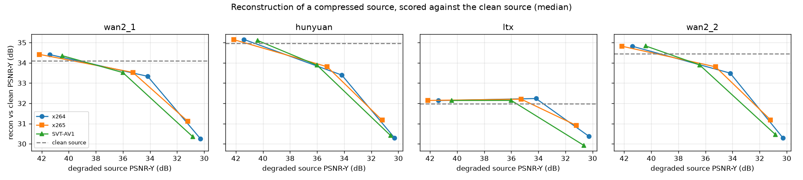
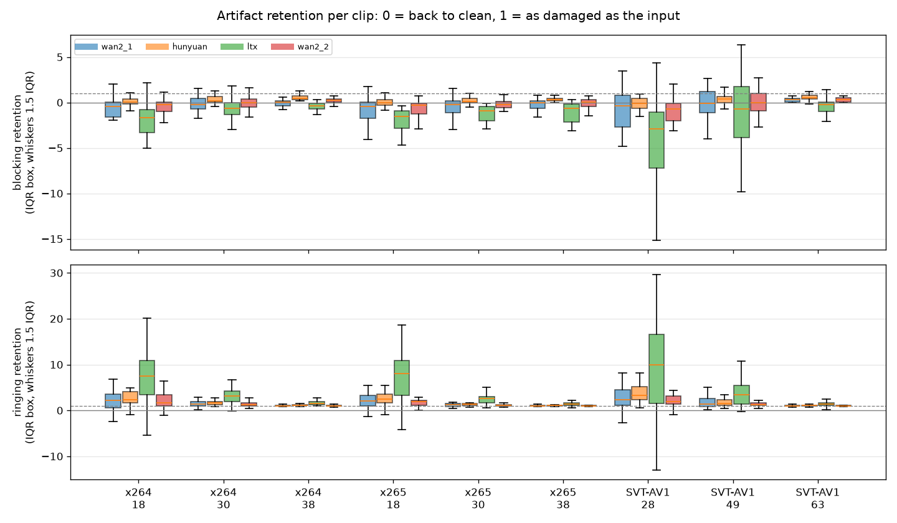

# LatentCodecBench

[](https://github.com/Shuvam1024/LatentCodecBench/actions/workflows/ci.yml)

LatentCodecBench measures the variational autoencoders inside open video generators as if they were codecs. It compares Wan2.1, Wan2.2, LTX-Video, and HunyuanVideo with x264, x265, and SVT-AV1 on rate-distortion, temporal stability, and throughput, and checks whether compression artifacts in the source video show up in the latent.

## Research questions

1. How do these video VAEs compare with x264, x265, and SVT-AV1 on rate-distortion, temporal stability, and throughput?
2. Do classic-codec artifacts in the source video leak into the VAE latent?
3. Can a lightweight decoder-side post-filter recover quality? The design is still open.

## Status

| Phase | Scope | Status |
| --- | --- | --- |
| 0. Foundation | Package, CI, docs | Done |
| 1. Data and classic codecs | Clips, metrics, x264 / x265 / SVT-AV1 | Done |
| 2. Video VAEs | Wan, LTX-Video, HunyuanVideo as codecs | Done |
| 3. Codec leak | Source-codec artifacts in the latent | 3.1, 3.2, and 3.4 done; 3.3 is future work |
| 4. Post-filter | Lightweight decoder-side filter; design not chosen | Future work |
| 5. Write-up | Report, figures, public release | Done |

The full step list is in [docs/PLAN.md](docs/PLAN.md). Design notes are in [docs/decisions/](docs/decisions/). Short concept notes are in [docs/learn/](docs/learn/).

## Future work

Two items were left out of v1.0.0.

- **3.3 Linear probe.** Predict the source QP or CRF from the latent, cross-validated, with confidence intervals. That would show whether the source quantizer is linearly readable, which is a stronger claim than the latent distance already measured. It needs a GPU.
- **Phase 4.** A lightweight decoder-side post-filter to recover quality. The design is still to be decided. It would show whether a cheap correction after the decoder can raise reconstruction quality.

## Published numbers

These two tables are rebuilt from the committed CSVs. The figures are in the sections below: classic curves under `docs/figures/`, and the VAE and propagation curves under `docs/results/`.

One command checks that this page, the learn notes, and the derived CSVs still match those tables, and it redraws the figures into a temporary directory. It does not re-encode a clip or run a VAE. Run it from the repository root.

```bash
uv run lcb reproduce
```

| Codec | Against | Metric | BD-rate | Clips in the mean | Mean overlap | Under 75% |
| --- | --- | --- | ---: | ---: | ---: | ---: |
| x265 | x264 | PSNR-Y | -24.66% | 34 | 85.37% | 0 |
| SVT-AV1 | x264 | PSNR-Y | -41.99% | 34 | 80.98% | 7 |
| x265 | x264 | VMAF | -20.44% | 34 | 84.45% | 2 |
| SVT-AV1 | x264 | VMAF | -44.86% | 34 | 77.66% | 12 |
| wan2_1 | x264 | PSNR-Y | +824.24% | 33 | 32.27% | 33 |
| wan2_1 | x264 | VMAF | +643.08% | 33 | 61.88% | 23 |
| hunyuan | x264 | PSNR-Y | +725.09% | 32 | 35.30% | 32 |
| hunyuan | x264 | VMAF | +583.16% | 30 | 60.80% | 24 |
| ltx | x264 | PSNR-Y | +397.92% | 26 | 20.30% | 26 |
| ltx | x264 | VMAF | +205.95% | 25 | 41.95% | 25 |
| wan2_2 | x264 | PSNR-Y | +628.61% | 33 | 42.94% | 28 |
| wan2_2 | x264 | VMAF | +568.29% | 33 | 66.02% | 24 |

| VAE | Clips | Mean PSNR-Y | Mean VMAF |
| --- | ---: | ---: | ---: |
| wan2_1 | 34 | 34.57 dB | 86.40 |
| hunyuan | 34 | 35.11 dB | 87.63 |
| ltx | 34 | 32.30 dB | 74.56 |
| wan2_2 | 34 | 35.35 dB | 87.13 |

The long form of each phase is in the sections below and in [docs/learn/](docs/learn/). The technical report, with confidence intervals and limitations, is [docs/REPORT.md](docs/REPORT.md). How the command decides that a page still matches is [docs/learn/12-reproducing-the-tables.md](docs/learn/12-reproducing-the-tables.md).


## Repository layout

CPU code, tests, and codec baselines live in the package. GPU runs (VAE inference) live in notebooks and run on Colab.

```text
src/latentcodecbench/    importable package
  data/                  clip manifests and preprocessing (phase 1)
  metrics/               PSNR, SSIM, LPIPS, VMAF, temporal metrics (phase 1)
  codecs/                x264, x265, SVT-AV1 (phase 1)
  vaes/                  Wan, LTX-Video, HunyuanVideo wrappers (phase 2)
  analysis/              rate-distortion, BD-rate, codec-leak probes (phases 1–3)
  postfilter/            decoder-side post-filter (phase 4, design open)
  testing.py             synthetic clips for tests
  cli.py                 `lcb` entry point
tests/                   pytest
notebooks/               Colab drivers for GPU work
docs/                    plan, devlog, ADRs, concept notes
manifests/clips.yaml     source list: URL, license, geometry, SHA256
DATA.md                  licenses and which sources are already compressed
```

`/data/`, `/results/`, and `/checkpoints/` are gitignored. Video bytes never land in a commit.

## Clip set

The checked-in list is [manifests/clips.yaml](manifests/clips.yaml): 34 sources, each with a URL, a license, native resolution and frame rate, and a SHA256. Licenses, and which of those sources are already compressed, are written out in [DATA.md](DATA.md). The shape every later stage sees is 832×480, 33 frames, 8-bit 4:2:0 y4m. [ADR-0002](docs/decisions/0002-canonical-clips.md) records why.

```bash
uv run lcb data fetch
```

That command downloads each source, deletes a file whose SHA256 does not match, and writes `data/clips/{id}.y4m`. For the large Xiph derf files the digest covers a 33-frame byte range. For UVG and the camera clips it covers the whole file.

## Classic codec baselines

The first measured curves are x264, x265, and SVT-AV1 on all 34 canonical clips (832×480, 33 frames). Presets are `medium`, `medium`, and SVT-AV1 preset 6, six CRF points each, one thread. x264 and x265 use CRF 18, 22, 26, 30, 34, 38. SVT-AV1 uses 28, 35, 42, 49, 56, 63. The tidy table is [docs/results/classic-baselines.csv](docs/results/classic-baselines.csv) (612 rows). Run id `20261008T010001Z-1a9353d785d3-baa565d2b8a8` names the revision that executed the sweep.

BD-rate against x264, the mean of the per-clip PCHIP integrals. Negative means fewer bits for the same quality. Every clip had a shared quality range, so none were skipped. Overlap is the length of that shared range divided by the length of the union. The mean is in the table. A pair under 75% stays in the mean and is flagged in [docs/results/overlap.csv](docs/results/overlap.csv): the integral on that clip only covers the band both curves reach.

| Codec | BD-rate, PSNR-Y | Mean overlap, PSNR-Y | BD-rate, VMAF | Mean overlap, VMAF |
| --- | --- | --- | --- | --- |
| x265 | -24.66% | 85.37% | -20.44% | 84.45% |
| SVT-AV1 | -41.99% | 80.98% | -44.86% | 77.66% |

Pairs under 75%:

- x265 on VMAF, 2 of 34: `controlled_burn`, `rust_laser`. PSNR-Y is at or above 75% on every clip.
- SVT-AV1 on PSNR-Y, 7 of 34: `controlled_burn`, `four_people`, `johnny`, `kristen_and_sara`, `pedestrian_area`, `sintel_trailer`, `snow_mnt`.
- SVT-AV1 on VMAF, 12 of 34: `controlled_burn`, `dinner`, `four_people`, `honey_bee`, `in_to_tree`, `johnny`, `kristen_and_sara`, `lawn_mower`, `old_town_cross`, `pedestrian_area`, `sintel_trailer`, `snow_mnt`.

Those are mostly easy clips. SVT-AV1 at CRF 63, the top of its dial, is still cleaner there than x264 at CRF 38. The BD-rate on that clip is the high-quality band the curves share. It does not describe x264 once x264 has gone softer than SVT-AV1 can.


Four of the 34 clips (`street_50`, `lawn_mower`, `rust_laser`, `volcano`) were already Theora or VP9, so those rows are a re-encode. Derf and UVG are not. LPIPS is blank in this table: the sweep ran without PyTorch. [ADR-0005](docs/decisions/0005-codec-baselines.md) and [ADR-0006](docs/decisions/0006-rd-curves-and-bd-rate.md) record the knobs and the BD-rate definition.

## VAE reconstruction

The uncoded reconstruction of the same 34 clips is [docs/results/vae-recon.csv](docs/results/vae-recon.csv) (136 rows, one per clip and VAE). No latent is quantized, so `crf`, `bits`, `bpp`, and `kbps` are empty, and the curves above stay the classic codecs. `lpips` is empty because this pass does not score it. Hunyuan ran with spatial tiling on. The other three did not. Runtime is bfloat16 on an NVIDIA L4. Run id `20261020T135251Z-5e6307722225-8af5cb8e9b39`. [ADR-0009](docs/decisions/0009-reconstruction-sweep.md).

Mean time is encode plus decode.

| VAE | Mean PSNR-Y | Median PSNR-Y | Mean VMAF | Median VMAF | Mean time (s) |
| --- | --- | --- | --- | --- | --- |
| wan2_1 | 34.57 | 34.10 | 86.40 | 89.21 | 10.76 |
| hunyuan | 35.11 | 34.96 | 87.63 | 89.69 | 24.54 |
| ltx | 32.30 | 31.98 | 74.56 | 78.62 | 0.88 |
| wan2_2 | 35.35 | 34.45 | 87.13 | 90.85 | 9.49 |

The bitrate of those latents is [docs/results/vae-bitrate.csv](docs/results/vae-bitrate.csv) (816 rows, six bit depths on each clip and VAE). `configs/vae-bitrate.yaml` quantizes the normalized posterior mean at bit depths 2, 4, 6, 8, 10, and 12, compresses the integer codes with zstd, and fills `crf`, `bits`, `bpp`, and `kbps`. `crf` there is the bit depth. `lpips` is empty. `entropy_bits` is a cross-entropy estimate and is not added into `bits`. Quality levels off from about depth 8. The per-depth means are in [docs/learn/05-latent-bitrate.md](docs/learn/05-latent-bitrate.md). Run id `20261020T234203Z-8cb0b7cd9bc4-17ec7df8f1e6`. Runtime is bfloat16 on an NVIDIA L4. [ADR-0010](docs/decisions/0010-latent-bitrate.md).

## VAE rate-distortion

The same rows against the Phase 1 codecs, with the Phase 1 PCHIP. Depth 2 is left out of the integral. A clip whose curves do not overlap, or whose quality falls as the rate rises, is undefined rather than extrapolated. Mean BD-rate against x264 on PSNR-Y: Wan2.1 +824.24% (33 clips, mean overlap 32.27%), Hunyuan +725.09% (32, 35.30%), Wan2.2 +628.61% (33, 42.94%), LTX +397.92% (26, 20.30%). Every one of those PSNR pairs is under 75% overlap. The full table, including x265 and SVT-AV1, is [docs/learn/09-vae-rd-curves.md](docs/learn/09-vae-rd-curves.md). [ADR-0011](docs/decisions/0011-vae-bd-rate.md).


## Source artifacts

Phase 3 asks whether compression in the source is still visible in the VAE latent. The study re-encodes each clip with x264, x265, and SVT-AV1 at three CRF points taken from the Phase 1 ladders, then compares the clean latent with the degraded one. The definitions and the full reading are in [docs/learn/10-artifact-propagation.md](docs/learn/10-artifact-propagation.md). The same rows, read as a training-data filter, are in [docs/learn/11-training-data-filter.md](docs/learn/11-training-data-filter.md). [ADR-0012](docs/decisions/0012-artifact-propagation.md).

The table is [docs/results/artifact-propagation.csv](docs/results/artifact-propagation.csv): 1224 rows, 34 clips, four VAEs, x264 and x265 at CRF 18, 30, 38 and SVT-AV1 at CRF 28, 49, 63. Run id `20261021T214039Z-933d37d99d88-3d42134b58f8`, bfloat16 on an NVIDIA L4. Medians over the clips:

- **The damage reaches the latent, and grows with CRF.** Relative L2 to the clean latent rises with CRF on every clip, VAE, and codec. Through x264 CRF 18, 30, 38 it is 0.099, 0.219, 0.324 for Hunyuan and 0.188, 0.410, 0.556 for Wan2.2.
- **The VAE copies the damage rather than repairing it.** The reconstruction is closer to the degraded input than to the clean source on all 1224 rows. At x264 CRF 38 it scores 30.26 to 30.38 dB against the clean source, next to the degraded input's 30.28 dB.
- **Mild compression is free.** At x264/x265 CRF 18 and SVT-AV1 CRF 28 the reconstruction is within -0.03 to +0.23 dB of the clean-source reconstruction. The VAE's own error is larger than the codec's.
- **Retention needs robust statistics.** Per-clip blocking retention reaches -1403 because the codec barely moved the score on some clips. Medians and IQRs are reported. The ringing score falls under compression on 87.7% of rows, so it reads as edge softening.
- **x265 and SVT-AV1 did not reproduce their own files.** The degraded set was rebuilt between Colab sessions. x264 matched bit for bit; SVT-AV1 differed on 18 clips by up to 1.35 dB.





## Quickstart

Install [uv](https://docs.astral.sh/uv/getting-started/installation/), then:

```bash
git clone https://github.com/Shuvam1024/LatentCodecBench.git
cd LatentCodecBench
uv sync
uv run lcb --version
uv run pytest
uv run lcb reproduce
```

`lcb reproduce` checks the published tables against the committed CSVs. It does not re-run the GPU sweeps.

`uv sync` installs the CPU environment from `uv.lock`: NumPy, Ruff, mypy, and pytest. PyTorch and Diffusers are optional, for later phases:

```bash
uv sync --extra gpu   # PyTorch
uv sync --extra vae   # PyTorch, Diffusers, and the libraries that load the VAEs
```

Metrics and codec baselines need an ffmpeg that includes libx264, libx265, libsvtav1, and libvmaf. Ubuntu's package has the three encoders and does not ship libvmaf, so CI installs the pinned build from [scripts/install-ffmpeg.sh](scripts/install-ffmpeg.sh). [ADR-0003](docs/decisions/0003-pinned-ffmpeg.md) records the version and the checksum.

## License

The code in this repository is MIT. Copyright (c) 2026 Shuvam Mukherjee. See [LICENSE](LICENSE).

The VAE weights are not in git, and they are not under that MIT license. Wan2.1 and Wan2.2 are Apache-2.0. The pinned LTX-Video `vae/` file is the 2B v0.9 weight under RAIL-M (academic and research use); the LTXV Open Weights License 0.X covers 0.9.6 and later and does not cover that file. HunyuanVideo is under the Tencent Hunyuan Community License, which does not apply in the EU, the UK, or South Korea, and whose section 5(b) restricts using the weights to improve other AI models. Revisions and license URLs are in [docs/learn/07-pins-and-licenses.md](docs/learn/07-pins-and-licenses.md) and [ADR-0008](docs/decisions/0008-vae-checkpoints.md). Clip licenses are in [DATA.md](DATA.md).
