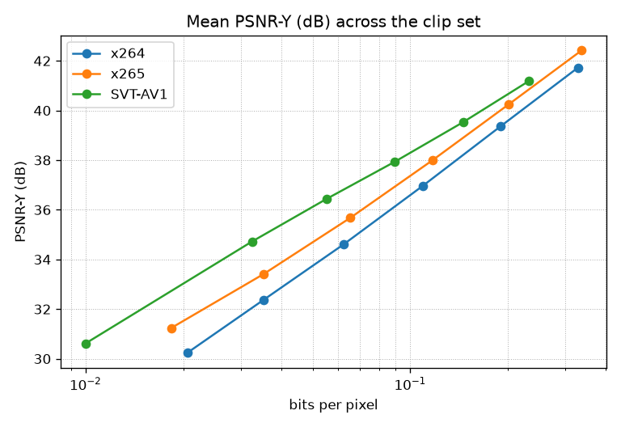
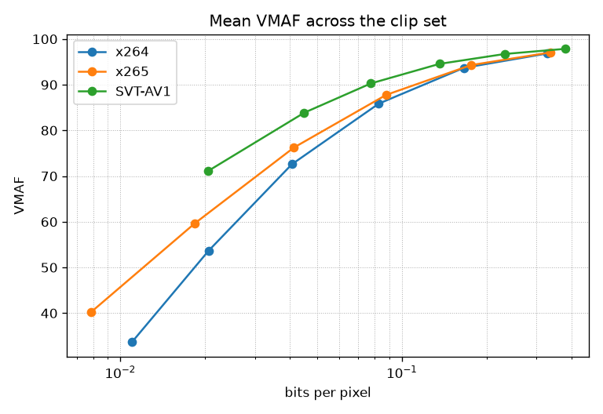

# LatentCodecBench

[](https://github.com/Shuvam1024/LatentCodecBench/actions/workflows/ci.yml)

LatentCodecBench measures the variational autoencoders inside open video generators as if they were codecs. It compares Wan2.1, Wan2.2, LTX-Video, and HunyuanVideo with x264, x265, and SVT-AV1 on rate-distortion, temporal stability, and throughput; checks whether compression artifacts in the source video show up in the latent; and tests whether a tiny decoder-side post-filter can buy back quality under a fixed compute budget.

## Research questions

1. How do these video VAEs compare with x264, x265, and SVT-AV1 on rate-distortion, temporal stability, and throughput?
2. Do classic-codec artifacts in the source video leak into the VAE latent?
3. Can a tiny decoder-side post-filter recover quality at a fixed compute budget?

## Status

| Phase | Scope | Status |
| --- | --- | --- |
| 0. Foundation | Package, CI, docs | Done |
| 1. Data and classic codecs | Clips, metrics, x264 / x265 / SVT-AV1 | In review |
| 2. Video VAEs | Wan, LTX-Video, HunyuanVideo as codecs | Not started |
| 3. Codec leak | Source-codec artifacts in the latent | Not started |
| 4. Post-filter | Tiny decoder-side network, fixed compute | Not started |
| 5. Write-up | Report, figures, public release | Not started |

The full step list is in [docs/PLAN.md](docs/PLAN.md). Design notes are in [docs/decisions/](docs/decisions/). Short concept notes are in [docs/learn/](docs/learn/).

## Repository layout

CPU code, tests, and codec baselines live in the package. GPU runs (VAE inference, post-filter training) live in notebooks and run on Colab.

```text
src/latentcodecbench/    importable package
  data/                  clip manifests and preprocessing (phase 1)
  metrics/               PSNR, SSIM, LPIPS, VMAF, temporal metrics (phase 1)
  codecs/                x264, x265, SVT-AV1 (phase 1)
  vaes/                  Wan, LTX-Video, HunyuanVideo wrappers (phase 2)
  analysis/              rate-distortion, BD-rate, codec-leak probes (phases 1–3)
  postfilter/            decoder-side network (phase 4)
  testing.py             synthetic clips for tests
  cli.py                 `lcb` entry point
tests/                   pytest
notebooks/               Colab drivers for GPU work
docs/                    plan, devlog, ADRs, concept notes
manifests/clips.yaml     source list: URL, license, geometry, SHA256
DATA.md                  licenses and which sources are already compressed
```

`/data/`, `/results/`, and `/checkpoints/` are gitignored. Video bytes never land in a commit.

## Clip set

The checked-in list is [manifests/clips.yaml](manifests/clips.yaml): 34 sources, each with a URL, a license, native resolution and frame rate, and a SHA256. Licenses, and which of those sources are already compressed, are written out in [DATA.md](DATA.md). The shape every later stage sees is 832×480, 33 frames, 8-bit 4:2:0 y4m. [ADR-0002](docs/decisions/0002-canonical-clips.md) records why.

```bash
uv run lcb data fetch
```

That command downloads each source, deletes a file whose SHA256 does not match, and writes `data/clips/{id}.y4m`. For the large Xiph derf files the digest covers a 33-frame byte range. For UVG and the camera clips it covers the whole file.

## Classic codec baselines

The first measured curves are x264, x265, and SVT-AV1 on all 34 canonical clips (832×480, 33 frames). Presets are `medium`, `medium`, and SVT-AV1 preset 6, six CRF points each, one thread. x264 and x265 use CRF 18, 22, 26, 30, 34, 38. SVT-AV1 uses 28, 35, 42, 49, 56, 63. The tidy table is [docs/results/classic-baselines.csv](docs/results/classic-baselines.csv) (612 rows). Run id `20261008T010001Z-1a9353d785d3-baa565d2b8a8` names the revision that executed the sweep.

BD-rate against x264, the mean of the per-clip PCHIP integrals. Negative means fewer bits for the same quality. Every clip had a shared quality range, so none were skipped. Overlap is the length of that shared range divided by the length of the union. The mean is in the table. A pair under 75% stays in the mean and is flagged in [docs/results/overlap.csv](docs/results/overlap.csv): the integral on that clip only covers the band both curves reach.

| Codec | BD-rate, PSNR-Y | Mean overlap, PSNR-Y | BD-rate, VMAF | Mean overlap, VMAF |
| --- | --- | --- | --- | --- |
| x265 | -24.66% | 85.37% | -20.44% | 84.45% |
| SVT-AV1 | -41.99% | 80.98% | -44.86% | 77.66% |

Pairs under 75%:

- x265 on VMAF, 2 of 34: `controlled_burn`, `rust_laser`. PSNR-Y is at or above 75% on every clip.
- SVT-AV1 on PSNR-Y, 7 of 34: `controlled_burn`, `four_people`, `johnny`, `kristen_and_sara`, `pedestrian_area`, `sintel_trailer`, `snow_mnt`.
- SVT-AV1 on VMAF, 12 of 34: `controlled_burn`, `dinner`, `four_people`, `honey_bee`, `in_to_tree`, `johnny`, `kristen_and_sara`, `lawn_mower`, `old_town_cross`, `pedestrian_area`, `sintel_trailer`, `snow_mnt`.

Those are mostly easy clips. SVT-AV1 at CRF 63, the top of its dial, is still cleaner there than x264 at CRF 38. The BD-rate on that clip is the high-quality band the curves share. It does not describe x264 once x264 has gone softer than SVT-AV1 can.





Four of the 34 clips (`street_50`, `lawn_mower`, `rust_laser`, `volcano`) were already Theora or VP9, so those rows are a re-encode. Derf and UVG are not. LPIPS is blank in this table: the sweep ran without PyTorch. [ADR-0005](docs/decisions/0005-codec-baselines.md) and [ADR-0006](docs/decisions/0006-rd-curves-and-bd-rate.md) record the knobs and the BD-rate definition.

## VAE reconstruction

The uncoded reconstruction of the same 34 clips is [docs/results/vae-recon.csv](docs/results/vae-recon.csv) (136 rows, one per clip and VAE). No latent is quantized, so `crf`, `bits`, `bpp`, and `kbps` are empty, and the curves above stay the classic codecs. `lpips` is empty because this pass does not score it. Hunyuan ran with spatial tiling on. The other three did not. Runtime is bfloat16 on an NVIDIA L4. Run id `20261020T135251Z-5e6307722225-8af5cb8e9b39`. [ADR-0009](docs/decisions/0009-reconstruction-sweep.md).

Mean time is encode plus decode.

| VAE | Mean PSNR-Y | Median PSNR-Y | Mean VMAF | Median VMAF | Mean time (s) |
| --- | --- | --- | --- | --- | --- |
| wan2_1 | 34.57 | 34.10 | 86.40 | 89.21 | 10.76 |
| hunyuan | 35.11 | 34.96 | 87.63 | 89.69 | 24.54 |
| ltx | 32.30 | 31.98 | 74.56 | 78.62 | 0.88 |
| wan2_2 | 35.35 | 34.45 | 87.13 | 90.85 | 9.49 |

The bitrate of those latents is a separate table. `configs/vae-bitrate.yaml` quantizes the normalized posterior mean at bit depths 2, 4, 6, 8, 10, and 12, compresses the integer codes with zstd, and fills `crf`, `bits`, `bpp`, and `kbps`. `crf` there is the bit depth. The 816 rows are the Colab notebook `notebooks/vae_bitrate.ipynb`. [ADR-0010](docs/decisions/0010-latent-bitrate.md).

## Quickstart

Install [uv](https://docs.astral.sh/uv/getting-started/installation/), then:

```bash
git clone https://github.com/Shuvam1024/LatentCodecBench.git
cd LatentCodecBench
uv sync
uv run lcb --version
uv run pytest
```

`uv sync` installs the CPU environment from `uv.lock`: NumPy, Ruff, mypy, and pytest. PyTorch and Diffusers are optional, for later phases:

```bash
uv sync --extra gpu   # PyTorch
uv sync --extra vae   # PyTorch, Diffusers, and the libraries that load the VAEs
```

Metrics and codec baselines need an ffmpeg that includes libx264, libx265, libsvtav1, and libvmaf. Ubuntu's package has the three encoders and does not ship libvmaf, so CI installs the pinned build from [scripts/install-ffmpeg.sh](scripts/install-ffmpeg.sh). [ADR-0003](docs/decisions/0003-pinned-ffmpeg.md) records the version and the checksum.

## License

MIT. Copyright (c) 2026 Shuvam Mukherjee. See [LICENSE](LICENSE).
