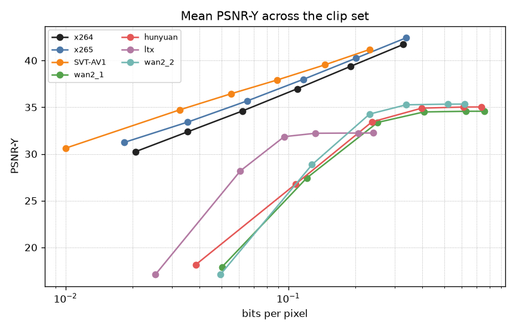
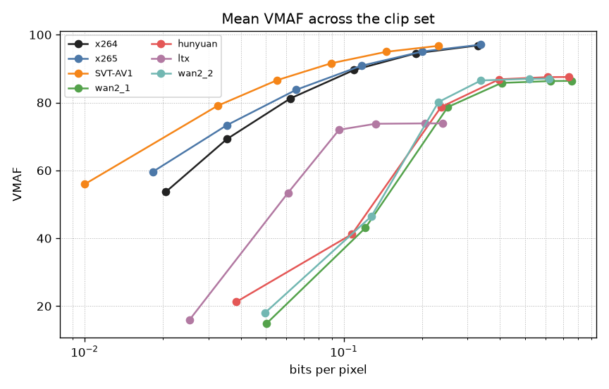
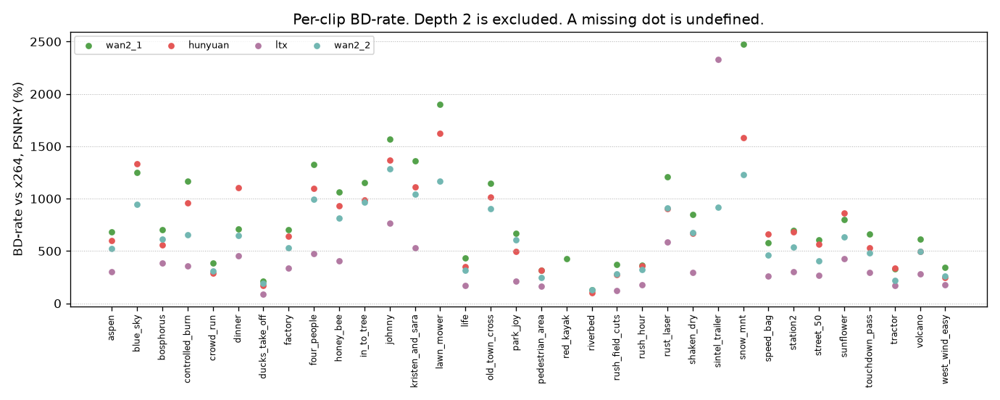

# The VAEs on the same axes as x264

Note 03 defines BD-rate: the average rate gap, in percent, over the quality range both curves actually cover. The interpolant is the same PCHIP. Negative would mean the test codec spends fewer bits than the anchor. The numbers below are positive. The anchor for the headline is x264. The same integral is also run against x265 and SVT-AV1.

The rate is `bpp` from the zstd file in step 2.4. `entropy_bits` is a cross-entropy estimate. It is not added into `bits`, and it is not the rate in this integral.

## Which samples count

Depth 2 is about 17 to 18 dB. x264's softest point on this set is about 30 dB. Depth 2 sits under the classic ladder, so it widens the union and bends the first cubic without adding a shared operating point. It is left out of the integral and kept on the figure. ADR-0011.

After that cut, a clip needs four points on each curve, with quality rising as rate rises, and a shared quality range. If quality falls as the rate goes up, the clip is non-monotonic and the BD-rate is undefined. `sintel_trailer` is the usual case. If the ranges never meet, the clip is `no_overlap`, also undefined. The integral stops at the last shared sample. Qualities above a VAE's best measured point are left blank.

A defined pair whose overlap is under 75% stays in the mean, and the overlap is printed beside the percent. That is the ADR-0006 rule. On PSNR-Y, every defined pair against x264 is under that line.

`scripts/summarize-vae-rd.py` rebuilds the table from `docs/results/classic-baselines.csv` and `docs/results/vae-bitrate.csv`. The per-clip rows, including the undefined ones, are `docs/results/vae-rd-bdrate.csv`.

| VAE | Anchor | Metric | BD-rate | Defined | No overlap | Non-monotonic | Too few | Mean overlap | Under 75% |
| --- | --- | --- | --- | --- | --- | --- | --- | --- | --- |
| wan2_1 | x264 | PSNR-Y | +824.24% | 33 | 0 | 1 | 0 | 32.27% | 33 |
| wan2_1 | x264 | VMAF | +643.08% | 33 | 0 | 1 | 0 | 61.88% | 23 |
| wan2_1 | x265 | PSNR-Y | +1164.59% | 29 | 4 | 1 | 0 | 27.97% | 29 |
| wan2_1 | x265 | VMAF | +909.57% | 33 | 0 | 1 | 0 | 50.63% | 31 |
| wan2_1 | SVT-AV1 | PSNR-Y | +1683.67% | 30 | 3 | 1 | 0 | 34.03% | 29 |
| wan2_1 | SVT-AV1 | VMAF | +1355.04% | 33 | 0 | 1 | 0 | 50.32% | 29 |
| hunyuan | x264 | PSNR-Y | +725.09% | 32 | 0 | 2 | 0 | 35.30% | 32 |
| hunyuan | x264 | VMAF | +583.16% | 30 | 0 | 4 | 0 | 60.80% | 24 |
| hunyuan | x265 | PSNR-Y | +1014.56% | 29 | 3 | 2 | 0 | 30.12% | 29 |
| hunyuan | x265 | VMAF | +819.77% | 30 | 0 | 4 | 0 | 49.69% | 30 |
| hunyuan | SVT-AV1 | PSNR-Y | +1415.43% | 29 | 3 | 2 | 0 | 36.18% | 29 |
| hunyuan | SVT-AV1 | VMAF | +1228.57% | 30 | 0 | 4 | 0 | 51.60% | 27 |
| ltx | x264 | PSNR-Y | +397.92% | 26 | 4 | 4 | 0 | 20.30% | 26 |
| ltx | x264 | VMAF | +205.95% | 25 | 1 | 8 | 0 | 41.95% | 25 |
| ltx | x265 | PSNR-Y | +605.37% | 20 | 10 | 4 | 0 | 17.06% | 20 |
| ltx | x265 | VMAF | +316.18% | 24 | 2 | 8 | 0 | 40.00% | 24 |
| ltx | SVT-AV1 | PSNR-Y | +939.05% | 26 | 4 | 4 | 0 | 20.25% | 26 |
| ltx | SVT-AV1 | VMAF | +481.30% | 23 | 3 | 8 | 0 | 40.36% | 23 |
| wan2_2 | x264 | PSNR-Y | +628.61% | 33 | 1 | 0 | 0 | 42.94% | 28 |
| wan2_2 | x264 | VMAF | +568.29% | 33 | 0 | 1 | 0 | 66.02% | 24 |
| wan2_2 | x265 | PSNR-Y | +960.89% | 30 | 4 | 0 | 0 | 36.91% | 28 |
| wan2_2 | x265 | VMAF | +783.27% | 33 | 0 | 1 | 0 | 55.57% | 28 |
| wan2_2 | SVT-AV1 | PSNR-Y | +1397.81% | 32 | 2 | 0 | 0 | 37.85% | 31 |
| wan2_2 | SVT-AV1 | VMAF | +1149.39% | 33 | 0 | 1 | 0 | 53.15% | 29 |

## What the percent is actually covering

+824.24% for Wan2.1 against x264 on PSNR-Y is about nine times the rate, on the clips where the curves meet. The shared band is the top of the VAE and the lower part of x264. x264's mean curve runs from about 30 dB at 0.02 bpp up to about 42 dB at 0.33 bpp. Wan2.1, past depth 2, runs from about 27 dB at 0.12 bpp and levels off near 35 dB while the rate keeps climbing past 0.7 bpp. They share the low 30s. There, x264 is still on its cheap CRFs and the VAE is already near its ceiling.

The same shape is why the curve flattens from about depth 8. Note 05 has the per-depth means: from depth 8 to depth 12 the mean PSNR-Y moves by a tenth of a decibel while the file gets larger. Those extra bits are real samples in the integral. They are also why a BD-rate here is a statement about a plateau, not about a codec that is still trading rate for quality.

The mean is pulled up by hard clips. The median per-clip PSNR-Y BD-rate against x264 is +694.29% for Wan2.1, +653.27% for Hunyuan, +603.24% for Wan2.2, and +299.08% for LTX. The per-clip chart shows the spread. A missing dot is an undefined clip.

## LTX sits further left, and lower

LTX's file is smaller. At depth 8 its median bpp is about a third of Wan2.1's, and its mean PSNR-Y stops near 32 dB with VMAF near 74. Where a BD-rate exists it is the smallest of the four: +397.92% against x264 on PSNR-Y, and +205.95% on VMAF. The overlap on PSNR-Y is about 20%. Four clips never meet x264 (`blue_sky`, `lawn_mower`, `riverbed`, `snow_mnt`), and four more are non-monotonic. The smaller percent is the lower slice of the classic curve, where LTX's rate is closer to x264's. LTX does not reach the top of that curve.

## Two caveats that travel with the number

The file is zstd on a uniform quantizer, with a 24-byte header counted in `bits`. It is not an entropy coder tuned to the latent. A matched coder could move a curve left. The ceiling would stay where the reconstruction already is: depth 12 matches the unquantized sweep within 0.1 dB on average. Moving left is a different experiment from raising the plateau.

Hunyuan on `sintel_trailer` is non-monotonic, so it is absent from the mean. Depth 12 there is 2.44 dB under the unquantized reconstruction, and depth 8 is already 2.38 dB under it. A value past the ends of `[-4, 4]` would stick on the end rung at every fine depth. The latent tensors are not in the repo, so that clipping account stays a hypothesis.

## Source

The integral and the 75% overlap flag are ADR-0006. The depth-2 cut, the undefined clips, and the refusal to extrapolate are [ADR-0011](../decisions/0011-vae-bd-rate.md). The rate column is [ADR-0010](../decisions/0010-latent-bitrate.md). Note 05 is the per-depth table. Note 03 is the worked BD-rate of -50%.
