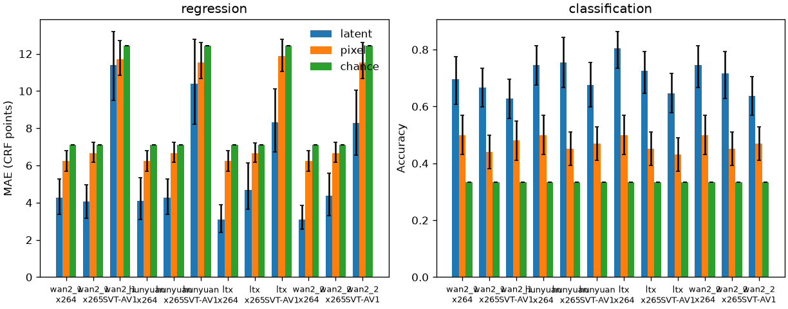

# Is the source rung readable in the latent?

Note 10 showed that a compressed source moves the posterior mean: relative L2 rises with CRF. A distance is not a reader. A linear probe asks a sharper question. Given the latent, and no other clip, can a linear function name the CRF the codec used, and can it name which of the three study rungs that CRF is? [ADR-0013](../decisions/0013-linear-probe.md).

## What is stored

The posterior mean is not the feature. It is a different shape for each VAE, and it is about a megabyte. The row stores the per-channel mean, standard deviation, and mean absolute value, padded to 128 channels, and one high-frequency energy. The same block is stored for the difference from the clean posterior mean. The clean clip is its own row, and that difference is zero. Six luma numbers from the y4m that was encoded are stored beside them. Those six are the baseline that never sees the latent. `source_sha256` is the hash of that y4m, because x265 and SVT-AV1 have not always reproduced their own files.

A row is about 10–15 KB of CSV. The study is 34 clips, four VAEs, and ten sources: 1360 rows. The notebook encodes and does not decode.

## How the fit refuses to cheat

The fit is one VAE and one codec at a time. CRF 38 on x264 and CRF 63 on SVT-AV1 are both the harsh end of their own ladder. They are not the same label, so they are not one model.

Each fold holds out a whole clip. The three rungs of that clip are scored by a model that has not seen the clip. A split that mixed the rows of one clip would train on the clip it then claims to predict.

The model is ridge with penalty 1 after the training columns are z-scored. The intercept is not penalized. A column that does not vary in the training clips is dropped, which is how the padding channels of a 16-channel VAE leave the fit. Classification is the same ridge onto the three rung indicators. The predicted rung is the indicator with the largest score.

Chance predicts the mean training CRF, and for the rung it predicts the most common training rung, breaking a tie toward the mildest. One of each rung makes that accuracy one third. The pixel model is the same ridge on the six luma numbers. If the latent model does not beat both, the latent is not adding a linear readout that the pixels, or the bare average, already have.

The number in the table is the mean across clips. The interval resamples clips 1000 times and takes the 2.5 and 97.5 percentiles. It is the clip-to-clip spread of that mean. It is not the error of one encode.

## Measured table

The feature CSV is `docs/results/latent-probe-features.csv.gz` (gzip of the Colab file, 1360 rows). The uncompressed SHA256 is `c759c29aad3a04dedaad52b795524a96aee00a9d266c6365d6bfadb60f0ace0f`. Run id `20261024T182512Z-5112c2552a5c-bcc52c3cc55f`, git `5112c2552a5c7e198f38996399a6e496f135e7b4`, config `bcc52c3cc55f5c45c7e45a0643a4e7dec6e4e6e7b533e55f4acf7e632f74d9ed`. One config, bfloat16 on an NVIDIA L4. `source_crf` and `preset` are empty on the 136 clean rows and nowhere else. Reprint the block below with:

```bash
uv run lcb probe fit \
  --features docs/results/latent-probe-features.csv.gz \
  --out docs/results/latent-probe.csv \
  --figure docs/results/latent-probe.png \
  --note docs/learn/14-linear-probe.md
```

<!-- probe-results:start -->

Leave-clip-out ridge, one VAE and one source codec at a time. Regression is mean absolute error in CRF points of that codec. Classification is accuracy on the three rungs of the study ladder. The interval is a 95% bootstrap over clips.

| VAE | Source | Task | Model | Clips | Estimate | 95% CI |
| --- | --- | --- | --- | ---: | ---: | --- |
| wan2_1 | x264 | regression | latent | 34 | 4.275 | [3.382, 5.288] |
| wan2_1 | x264 | regression | pixel | 34 | 6.243 | [5.694, 6.811] |
| wan2_1 | x264 | regression | chance | 34 | 7.111 | [7.111, 7.111] |
| wan2_1 | x264 | classification | latent | 34 | 0.696 | [0.608, 0.775] |
| wan2_1 | x264 | classification | pixel | 34 | 0.500 | [0.431, 0.569] |
| wan2_1 | x264 | classification | chance | 34 | 0.333 | [0.333, 0.333] |
| wan2_1 | x265 | regression | latent | 34 | 4.047 | [3.182, 4.976] |
| wan2_1 | x265 | regression | pixel | 34 | 6.670 | [6.171, 7.246] |
| wan2_1 | x265 | regression | chance | 34 | 7.111 | [7.111, 7.111] |
| wan2_1 | x265 | classification | latent | 34 | 0.667 | [0.598, 0.735] |
| wan2_1 | x265 | classification | pixel | 34 | 0.441 | [0.382, 0.500] |
| wan2_1 | x265 | classification | chance | 34 | 0.333 | [0.333, 0.333] |
| wan2_1 | SVT-AV1 | regression | latent | 34 | 11.402 | [9.501, 13.189] |
| wan2_1 | SVT-AV1 | regression | pixel | 34 | 11.695 | [10.834, 12.727] |
| wan2_1 | SVT-AV1 | regression | chance | 34 | 12.444 | [12.444, 12.444] |
| wan2_1 | SVT-AV1 | classification | latent | 34 | 0.627 | [0.559, 0.696] |
| wan2_1 | SVT-AV1 | classification | pixel | 34 | 0.480 | [0.412, 0.549] |
| wan2_1 | SVT-AV1 | classification | chance | 34 | 0.333 | [0.333, 0.333] |
| hunyuan | x264 | regression | latent | 34 | 4.085 | [3.099, 5.346] |
| hunyuan | x264 | regression | pixel | 34 | 6.243 | [5.694, 6.811] |
| hunyuan | x264 | regression | chance | 34 | 7.111 | [7.111, 7.111] |
| hunyuan | x264 | classification | latent | 34 | 0.745 | [0.676, 0.814] |
| hunyuan | x264 | classification | pixel | 34 | 0.500 | [0.431, 0.569] |
| hunyuan | x264 | classification | chance | 34 | 0.333 | [0.333, 0.333] |
| hunyuan | x265 | regression | latent | 34 | 4.275 | [3.368, 5.283] |
| hunyuan | x265 | regression | pixel | 34 | 6.664 | [6.172, 7.237] |
| hunyuan | x265 | regression | chance | 34 | 7.111 | [7.111, 7.111] |
| hunyuan | x265 | classification | latent | 34 | 0.755 | [0.667, 0.843] |
| hunyuan | x265 | classification | pixel | 34 | 0.451 | [0.392, 0.510] |
| hunyuan | x265 | classification | chance | 34 | 0.333 | [0.333, 0.333] |
| hunyuan | SVT-AV1 | regression | latent | 34 | 10.397 | [8.224, 12.796] |
| hunyuan | SVT-AV1 | regression | pixel | 34 | 11.551 | [10.660, 12.620] |
| hunyuan | SVT-AV1 | regression | chance | 34 | 12.444 | [12.444, 12.444] |
| hunyuan | SVT-AV1 | classification | latent | 34 | 0.676 | [0.598, 0.755] |
| hunyuan | SVT-AV1 | classification | pixel | 34 | 0.471 | [0.412, 0.529] |
| hunyuan | SVT-AV1 | classification | chance | 34 | 0.333 | [0.333, 0.333] |
| ltx | x264 | regression | latent | 34 | 3.083 | [2.390, 3.883] |
| ltx | x264 | regression | pixel | 34 | 6.243 | [5.694, 6.811] |
| ltx | x264 | regression | chance | 34 | 7.111 | [7.111, 7.111] |
| ltx | x264 | classification | latent | 34 | 0.804 | [0.735, 0.863] |
| ltx | x264 | classification | pixel | 34 | 0.500 | [0.431, 0.569] |
| ltx | x264 | classification | chance | 34 | 0.333 | [0.333, 0.333] |
| ltx | x265 | regression | latent | 34 | 4.697 | [3.654, 6.152] |
| ltx | x265 | regression | pixel | 34 | 6.654 | [6.160, 7.223] |
| ltx | x265 | regression | chance | 34 | 7.111 | [7.111, 7.111] |
| ltx | x265 | classification | latent | 34 | 0.725 | [0.647, 0.794] |
| ltx | x265 | classification | pixel | 34 | 0.451 | [0.392, 0.510] |
| ltx | x265 | classification | chance | 34 | 0.333 | [0.333, 0.333] |
| ltx | SVT-AV1 | regression | latent | 34 | 8.331 | [6.714, 10.111] |
| ltx | SVT-AV1 | regression | pixel | 34 | 11.872 | [11.059, 12.779] |
| ltx | SVT-AV1 | regression | chance | 34 | 12.444 | [12.444, 12.444] |
| ltx | SVT-AV1 | classification | latent | 34 | 0.647 | [0.578, 0.716] |
| ltx | SVT-AV1 | classification | pixel | 34 | 0.431 | [0.373, 0.490] |
| ltx | SVT-AV1 | classification | chance | 34 | 0.333 | [0.333, 0.333] |
| wan2_2 | x264 | regression | latent | 34 | 3.099 | [2.563, 3.855] |
| wan2_2 | x264 | regression | pixel | 34 | 6.243 | [5.694, 6.811] |
| wan2_2 | x264 | regression | chance | 34 | 7.111 | [7.111, 7.111] |
| wan2_2 | x264 | classification | latent | 34 | 0.745 | [0.667, 0.814] |
| wan2_2 | x264 | classification | pixel | 34 | 0.500 | [0.431, 0.569] |
| wan2_2 | x264 | classification | chance | 34 | 0.333 | [0.333, 0.333] |
| wan2_2 | x265 | regression | latent | 34 | 4.392 | [3.316, 5.588] |
| wan2_2 | x265 | regression | pixel | 34 | 6.664 | [6.172, 7.237] |
| wan2_2 | x265 | regression | chance | 34 | 7.111 | [7.111, 7.111] |
| wan2_2 | x265 | classification | latent | 34 | 0.716 | [0.627, 0.794] |
| wan2_2 | x265 | classification | pixel | 34 | 0.451 | [0.392, 0.510] |
| wan2_2 | x265 | classification | chance | 34 | 0.333 | [0.333, 0.333] |
| wan2_2 | SVT-AV1 | regression | latent | 34 | 8.282 | [6.540, 10.055] |
| wan2_2 | SVT-AV1 | regression | pixel | 34 | 11.551 | [10.660, 12.620] |
| wan2_2 | SVT-AV1 | regression | chance | 34 | 12.444 | [12.444, 12.444] |
| wan2_2 | SVT-AV1 | classification | latent | 34 | 0.637 | [0.569, 0.706] |
| wan2_2 | SVT-AV1 | classification | pixel | 34 | 0.471 | [0.412, 0.529] |
| wan2_2 | SVT-AV1 | classification | chance | 34 | 0.333 | [0.333, 0.333] |

Classification accuracy pooled across codecs. The model was still fit inside one codec. A clip's score is the mean of its per-codec accuracies, and the `all` row is that mean taken across VAEs as well. The interval resamples clips. Chance is the per-codec majority rung, pooled the same way.

| VAE | Source | Model | Clips | Accuracy | 95% CI |
| --- | --- | --- | ---: | ---: | --- |
| wan2_1 | pooled | latent | 34 | 0.663 | [0.611, 0.719] |
| wan2_1 | pooled | pixel | 34 | 0.474 | [0.418, 0.526] |
| wan2_1 | pooled | chance | 34 | 0.333 | [0.333, 0.333] |
| hunyuan | pooled | latent | 34 | 0.725 | [0.657, 0.794] |
| hunyuan | pooled | pixel | 34 | 0.474 | [0.425, 0.523] |
| hunyuan | pooled | chance | 34 | 0.333 | [0.333, 0.333] |
| ltx | pooled | latent | 34 | 0.725 | [0.676, 0.775] |
| ltx | pooled | pixel | 34 | 0.461 | [0.408, 0.510] |
| ltx | pooled | chance | 34 | 0.333 | [0.333, 0.333] |
| wan2_2 | pooled | latent | 34 | 0.699 | [0.641, 0.755] |
| wan2_2 | pooled | pixel | 34 | 0.474 | [0.425, 0.523] |
| wan2_2 | pooled | chance | 34 | 0.333 | [0.333, 0.333] |
| all | pooled | latent | 34 | 0.703 | [0.661, 0.743] |
| all | pooled | pixel | 34 | 0.471 | [0.420, 0.520] |
| all | pooled | chance | 34 | 0.333 | [0.333, 0.333] |

Clean versus degraded, one VAE at a time, on the same ridge and the same leave-clip-out split. Chance is the majority training class. A tie takes the clean class. The `all` row averages clip scores across VAEs.

| VAE | Source | Model | Clips | Accuracy | 95% CI |
| --- | --- | --- | ---: | ---: | --- |
| wan2_1 | clean-degraded | latent | 34 | 0.982 | [0.962, 0.997] |
| wan2_1 | clean-degraded | pixel | 34 | 0.900 | [0.900, 0.900] |
| wan2_1 | clean-degraded | chance | 34 | 0.900 | [0.900, 0.900] |
| hunyuan | clean-degraded | latent | 34 | 0.982 | [0.962, 0.997] |
| hunyuan | clean-degraded | pixel | 34 | 0.900 | [0.900, 0.900] |
| hunyuan | clean-degraded | chance | 34 | 0.900 | [0.900, 0.900] |
| ltx | clean-degraded | latent | 34 | 0.862 | [0.785, 0.924] |
| ltx | clean-degraded | pixel | 34 | 0.900 | [0.900, 0.900] |
| ltx | clean-degraded | chance | 34 | 0.900 | [0.900, 0.900] |
| wan2_2 | clean-degraded | latent | 34 | 0.953 | [0.903, 0.991] |
| wan2_2 | clean-degraded | pixel | 34 | 0.900 | [0.900, 0.900] |
| wan2_2 | clean-degraded | chance | 34 | 0.900 | [0.900, 0.900] |
| all | clean-degraded | latent | 34 | 0.945 | [0.920, 0.966] |
| all | clean-degraded | pixel | 34 | 0.900 | [0.900, 0.900] |
| all | clean-degraded | chance | 34 | 0.900 | [0.900, 0.900] |

Codec identity on the degraded rows only, three codecs, same ridge and same leave-clip-out split. The label is the codec, not the CRF. Chance is the majority training codec, and a tie takes the first codec on the study ladder. The `all` row averages clip scores across VAEs.

| VAE | Source | Model | Clips | Accuracy | 95% CI |
| --- | --- | --- | ---: | ---: | --- |
| wan2_1 | codec-id | latent | 34 | 0.536 | [0.480, 0.601] |
| wan2_1 | codec-id | pixel | 34 | 0.418 | [0.386, 0.454] |
| wan2_1 | codec-id | chance | 34 | 0.333 | [0.333, 0.333] |
| hunyuan | codec-id | latent | 34 | 0.660 | [0.595, 0.725] |
| hunyuan | codec-id | pixel | 34 | 0.399 | [0.366, 0.435] |
| hunyuan | codec-id | chance | 34 | 0.333 | [0.333, 0.333] |
| ltx | codec-id | latent | 34 | 0.529 | [0.474, 0.582] |
| ltx | codec-id | pixel | 34 | 0.431 | [0.392, 0.471] |
| ltx | codec-id | chance | 34 | 0.333 | [0.333, 0.333] |
| wan2_2 | codec-id | latent | 34 | 0.552 | [0.493, 0.611] |
| wan2_2 | codec-id | pixel | 34 | 0.399 | [0.366, 0.435] |
| wan2_2 | codec-id | chance | 34 | 0.333 | [0.333, 0.333] |
| all | codec-id | latent | 34 | 0.569 | [0.529, 0.609] |
| all | codec-id | pixel | 34 | 0.412 | [0.382, 0.444] |
| all | codec-id | chance | 34 | 0.333 | [0.333, 0.333] |

`source_sha256` disagrees across VAEs on 75 of 306 degraded (clip, codec, CRF) points (x265 36, SVT-AV1 39). x264 agrees. The rung model is fit inside one codec, so a within-codec comparison does not mix those files. A cross-VAE comparison at one of those points does.

<!-- probe-results:end -->



The bars are the per-codec fits in the table above: latent, the six-number pixel baseline, and chance. The interval is the clip bootstrap. Pooling across codecs is the table under the per-codec one, not a bar. The markdown rounds each entry to three decimal places. `docs/results/latent-probe.csv` stores the same fits as full floats, including the pooled rows and the two extra readouts.
